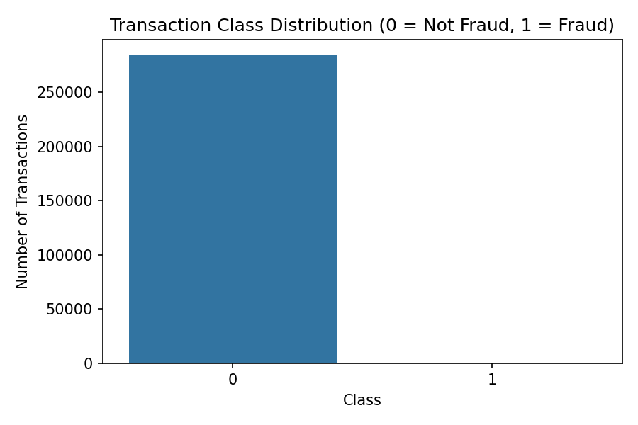
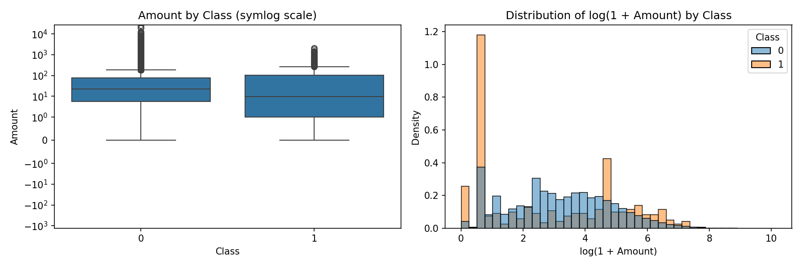
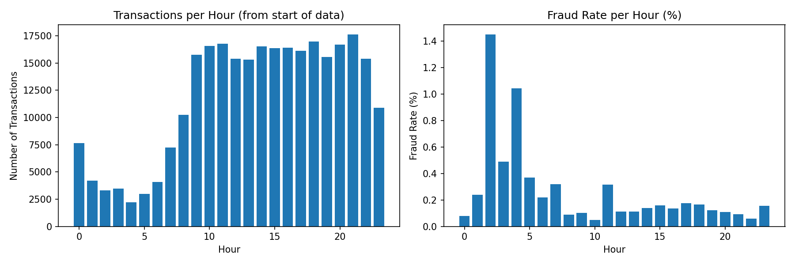
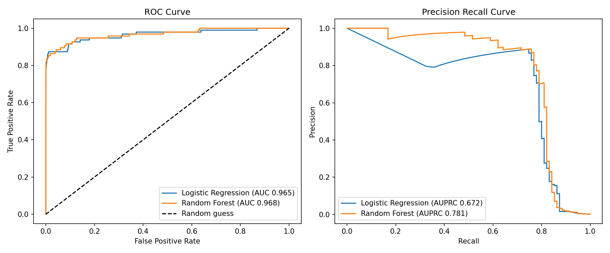
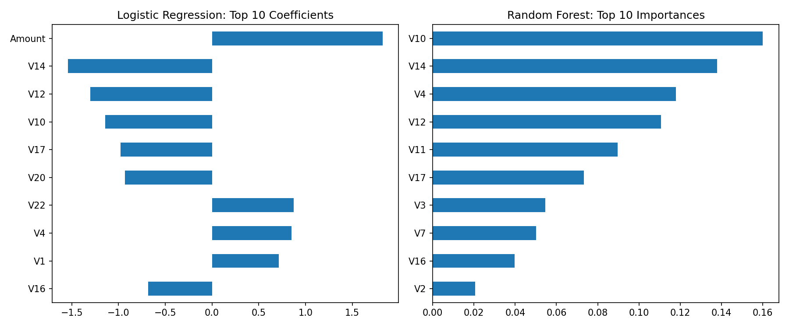

# Fraud Detection Using Machine Learning on an Imbalanced Transaction Dataset

**Author:** Peace Mmesoma Ekete
**Program:** Oasis Infobyte Internship Program (OIBSIP), Data Analytics track, Level 2, Task 3 (Fraud Detection)
**Notebook:** `Fraud_Detection.ipynb`

This folder contains the notebook with the full analysis and outputs, this README, and the figures used in the report (`class_distribution.png`, `amount_distribution.png`, `hour_analysis.png`, `roc_pr_curves.png` and `feature_importance.png`). The dataset file is not stored in this repository. The notebook downloads it when it runs.

---

## 1. Introduction

Fraud detection, in the context of financial transactions, means deciding whether a transaction is fraudulent or genuine using the information recorded about it. When past transactions have been labelled, this can be treated as a supervised classification problem, where a model learns from labelled examples and is then used to score new transactions.

Detecting fraud matters because a fraudulent transaction that goes unnoticed can cost the cardholder or the card issuer money. A genuine transaction that is wrongly stopped also causes a problem, because the cardholder is inconvenienced and someone may need to review the case. When the number of transactions is very large, checking each one by hand is not practical, so a model can be used to decide which transactions need attention.

The main difficulty in this type of problem is class imbalance. Fraudulent transactions are a very small part of all transactions, so a model can appear to perform well on a simple measure such as accuracy while detecting very little fraud. This project uses a public benchmark dataset and builds a pipeline that takes this imbalance into account in the way the data is split, the way the models are trained and the way they are evaluated.

The project is a learning exercise carried out on a benchmark dataset. It does not use live financial data and it was not tested in a real fraud detection system.

## 2. Problem Statement

The problem is to classify credit card transactions as fraudulent or not fraudulent. In the dataset used here, only about 0.17% of the transactions are fraudulent. A classifier that labels every transaction as not fraudulent would therefore be correct for more than 99.8% of transactions and would still detect no fraud at all. For this reason, ordinary classification accuracy cannot be the main way of judging the models. The project needs measures that describe how well the fraudulent transactions themselves are detected and how many genuine transactions are wrongly classified as fraud.

## 3. Aim and Objectives

**Aim:** To build and evaluate a machine learning pipeline that detects fraudulent credit card transactions in a heavily imbalanced dataset.

**Objectives:**

1. Load the dataset and examine the class distribution.
2. Investigate duplicate rows and decide how to handle them.
3. Explore the transaction amounts of fraudulent and non-fraudulent transactions.
4. Examine how fraud varies with the elapsed time in the dataset.
5. Explain why accuracy is not suitable as the main evaluation measure for this dataset.
6. Apply a class imbalance handling method.
7. Split the data into training and test sets in a way that keeps fraud cases in both.
8. Train a Logistic Regression model and a Random Forest model.
9. Evaluate the models using precision, recall, F1 score, ROC-AUC and the area under the precision-recall curve (AUPRC).
10. Discuss the trade-off between precision and recall, including the amount of money in the missed fraud cases.
11. Examine the Logistic Regression coefficients and the Random Forest feature importance.
12. Examine the transactions that Random Forest missed and wrongly classified as fraud.
13. Test the effect of changing the classification threshold.
14. Measure the scoring speed of both models and discuss whether the approach could handle 1 million transactions per hour.

## 4. Dataset Description

**Source.** The dataset is the Credit Card Fraud Detection dataset published on Kaggle. It was collected and analysed by Worldline and the Machine Learning Group of the Université Libre de Bruxelles (ULB). It contains transactions made by European cardholders over two days in September 2013.

**Size.** Before cleaning, the dataset has 284,807 rows and 31 columns.

**Variables.**

| Column | Description |
|---|---|
| `Time` | Seconds elapsed between the transaction and the first transaction in the dataset. It is not a clock time. |
| `V1` to `V28` | Anonymized numerical features. According to the dataset description, these are the result of a PCA transformation applied for confidentiality. Their original meaning is not provided. |
| `Amount` | The transaction amount. |
| `Class` | The target variable. 1 means the transaction is fraudulent and 0 means it is not. |

All columns are stored as floating point numbers except `Class`, which is an integer. Because V1 to V28 are anonymous, the analysis can show which of these variables the models used, but it cannot explain what they represent.

**Class distribution.** The dataset has 284,315 non-fraudulent transactions (99.8273%) and 492 fraudulent transactions (0.1727%). About 1 in every 580 transactions is fraudulent.

## 5. Data Understanding and Initial Inspection

The data was loaded into a pandas DataFrame. The shape was (284,807, 31). Every column contained 284,807 non-null values, and a direct count of missing values gave 0. The first rows showed that `Time` starts at 0.0 and that `Amount` contains ordinary payment values, for example 149.62, 2.69 and 378.66.

The class counts confirmed the figures given in the dataset description: 492 fraudulent transactions out of 284,807, which is 0.1727%.

**Figure 1: Distribution of fraudulent and non-fraudulent transactions**



Figure 1 shows the number of transactions in each class. The bar for fraudulent transactions is too small to be seen next to the bar for non-fraudulent transactions, which shows how uneven the classes are.

## 6. Data Cleaning

No missing values were found, so no values needed to be filled or removed. The only cleaning step was the handling of duplicate rows.

**Duplicate investigation.** The data contained 1,081 rows that were exact copies of another row. Of these, 1,062 belonged to the non-fraudulent class and 19 to the fraudulent class. The duplicates came from 773 transactions that appeared more than once:

| Copies of the transaction | Number of transactions |
|---|---|
| 2 | 611 |
| 3 | 66 |
| 4 | 81 |
| 5 | 10 |
| 6 | 1 |
| 9 | 2 |
| 18 | 2 |

I also checked whether any identical set of feature values appeared with different labels. None did, so the duplicates did not contradict each other. Among the duplicated fraud rows, one group consisted of six identical transactions with an amount of 1.00 at the same time value.

**Decision.** I could not tell from the data whether these rows were repeated records or separate transactions that happened in the same second. I removed them before modelling. If they remained, a transaction and its copy could be placed on different sides of the train and test split. The model would then be tested on a transaction it had already seen, which could make the test results look better than they should.

**Result.** After removal, the data had 283,726 rows. Of these, 283,253 were non-fraudulent and 473 were fraudulent (0.1667%). The original DataFrame was kept unchanged and the cleaned data was stored separately. All later analysis used the cleaned data.

Removing the duplicates reduced the number of fraud cases from 492 to 473. This means the results in this report cannot be compared directly with work that uses all 284,807 rows. If the repeated fraud rows were real separate transactions, removing them also removed some information about how fraud behaves.

## 7. Exploratory Data Analysis

### 7.1 Class Distribution

After duplicate removal, 0.1667% of the transactions were fraudulent (473 of 283,726). This extreme imbalance affects the rest of the project. It means that accuracy cannot be used as the main measure (Section 8), that the data split must keep fraud cases in both parts (Section 10), and that the training process needs to give the rare class enough weight (Section 9).

### 7.2 Transaction Amount Analysis

The amount of each transaction was compared between the two classes using the cleaned data.

| Statistic | Not fraud | Fraud |
|---|---|---|
| Count | 283,253 | 473 |
| Mean | 88.41 | 123.87 |
| Standard deviation | 250.38 | 260.21 |
| Minimum | 0.00 | 0.00 |
| 25th percentile | 5.67 | 1.00 |
| Median | 22.00 | 9.82 |
| 75th percentile | 77.46 | 105.89 |
| Maximum | 25,691.16 | 2,125.87 |

The median amount of fraudulent transactions (9.82) was lower than the median of non-fraudulent transactions (22.00), and the lower quarter of fraudulent transactions had an amount of 1.00 or less. The mean was higher for fraud (123.87 compared with 88.41), which suggests that a smaller number of larger fraud amounts raised the average. The largest non-fraudulent transaction (25,691.16) was much larger than the largest fraudulent one (2,125.87).

Transactions with an amount of exactly 0 were found in both classes: 1,783 non-fraudulent and 25 fraudulent transactions. This is 5.3% of the fraudulent transactions compared with 0.6% of the non-fraudulent ones.

Some amounts were common among the fraudulent transactions. The most frequent were 1.00 (105 transactions, about 22% of the fraud cases), 99.99 (27 transactions) and 0.00 (25 transactions).

**Figure 2: Transaction amount distribution by class**



Figure 2 has two parts. The left part is a boxplot of `Amount` for each class. A symlog scale was used because the amounts are very uneven and some are exactly 0, which a normal logarithmic scale cannot display. The right part is a histogram of log(1 + Amount). A logarithm was used because most amounts are small and a few are very large, so a plot on the original scale would show almost nothing apart from the smallest amounts. Each class was scaled to its own total, so that the 473 fraud cases can be compared with the 283,253 non-fraudulent ones. The histogram shows a tall bar for fraud near an amount of 1 and another near an amount of about 100.

Fraudulent transactions had a lower median amount than non-fraudulent transactions in this dataset. However, the two distributions overlapped considerably, so the amount alone was not enough to separate the classes.

### 7.3 Transaction Timing Analysis

The `Time` column is the number of seconds since the first transaction in the dataset. It is not a time of day. The values range from 0 to about 48 hours.

To look at timing, I converted `Time` into an hour value using `(Time // 3600) % 24`. This gives 24 groups, numbered 0 to 23, counted from the start of the data. Each group combines two hours, one from the first day and one from the second. The real clock time of the first transaction is not given, so these groups cannot be read as actual hours of the day. They can only be compared with each other.

| Hour | Transactions | Frauds | Fraud rate (%) |
|---|---|---|---|
| 0 | 7,647 | 6 | 0.078 |
| 1 | 4,208 | 10 | 0.238 |
| 2 | 3,308 | 48 | 1.451 |
| 3 | 3,487 | 17 | 0.488 |
| 4 | 2,204 | 23 | 1.044 |
| 5 | 2,988 | 11 | 0.368 |
| 6 | 4,082 | 9 | 0.220 |
| 7 | 7,233 | 23 | 0.318 |
| 8 | 10,232 | 9 | 0.088 |
| 9 | 15,767 | 16 | 0.101 |
| 10 | 16,548 | 8 | 0.048 |
| 11 | 16,781 | 53 | 0.316 |
| 12 | 15,378 | 17 | 0.111 |
| 13 | 15,323 | 17 | 0.111 |
| 14 | 16,520 | 23 | 0.139 |
| 15 | 16,374 | 26 | 0.159 |
| 16 | 16,396 | 22 | 0.134 |
| 17 | 16,130 | 28 | 0.174 |
| 18 | 16,959 | 28 | 0.165 |
| 19 | 15,566 | 19 | 0.122 |
| 20 | 16,705 | 18 | 0.108 |
| 21 | 17,629 | 16 | 0.091 |
| 22 | 15,378 | 9 | 0.059 |
| 23 | 10,883 | 17 | 0.156 |

**Figure 3: Transactions and fraud rate by elapsed hour**



The number of transactions was lower in hours 1 to 7 and higher in hours 9 to 22. This resembles a day and night pattern, but I cannot confirm this because the starting time is unknown. The fraud rate was highest in hour 2 (1.451%, 48 of 3,308 transactions) and hour 4 (1.044%, 23 of 2,204 transactions), compared with 0.1667% for the whole dataset. These two groups contain 71 of the 473 fraud cases (15%) but only about 1.9% of all transactions. Hour 11 had the largest number of fraud cases (53) but a lower rate (0.316%), because it is a busy hour.

This result should be interpreted carefully. The data covers only two days, so each hour group has only two occurrences, and a short burst of fraud could create a high rate. The pattern suggests that the fraud rate was higher when the number of transactions was low, but the data is not enough to treat it as a reliable pattern.

## 8. Why Accuracy Is Not Suitable as the Main Metric

Accuracy is the proportion of all predictions that are correct. In this dataset, 283,253 of the 283,726 transactions are not fraudulent. A classifier that predicts "not fraud" for every transaction would therefore be correct for 99.83% of the transactions. In the notebook, I calculated this baseline on the cleaned data. Its accuracy was 0.9983, but its recall for fraud was 0, because it did not detect any of the 473 fraud cases. It has a high accuracy only because the fraud class is so small.

The results of the real models show the same problem. Logistic Regression had an accuracy of 0.9750 on the test set, which is lower than the baseline, yet it identified 83 of the 95 fraud cases in the test set. Random Forest had an accuracy of 0.9992, which is only slightly higher than the baseline of 0.9983, but its F1 score for fraud was 0.7749. Accuracy therefore did not reflect the differences between these classifiers in how they treat fraud.

For this reason, I used the following measures, all calculated for the fraud class:

- **Precision** is the proportion of transactions classified as fraud that really were fraud. It shows how many false alerts the model produces.
- **Recall** is the proportion of real fraud cases that the model identified. It shows how much fraud is missed.
- **F1 score** combines precision and recall in a single value. It is low when either one is low.
- **ROC-AUC** measures how well the model ranks fraud transactions above non-fraudulent ones over all thresholds. It does not depend on one chosen threshold. Because there are very many non-fraudulent transactions, it can look high even when the model produces many false alerts. Both models had similar ROC-AUC values even though their precision was very different.
- **AUPRC** is the area under the precision-recall curve. It focuses on the fraud class and is affected by false alerts, so it is more informative when the positive class is rare. A model that ranked transactions randomly would have an AUPRC close to the fraud proportion, about 0.0017.

The task card asks for the ROC curve, so both the ROC-AUC and the AUPRC are reported.

## 9. Handling Class Imbalance

I used `class_weight="balanced"` in both models. With this setting, scikit-learn gives each class a weight that is inversely proportional to the number of training examples in the class, calculated as `n_samples / (n_classes * number of samples in the class)`. In the training data, this gives a weight of about 300.2 to each fraud transaction and about 0.5 to each non-fraudulent transaction (calculated from the formula, not printed in the notebook). This gives each fraud observation roughly 600 times the training weight of each non-fraudulent observation during training.


I chose this method because it does not change the data. It is applied inside the models and it does not create new transactions. **SMOTE was not used**, and no synthetic fraud transactions were created. Undersampling was also not used, so no non-fraudulent transactions were removed from the training data.

## 10. Train/Test Split

The cleaned data was divided into a training set and a test set in an 80% to 20% ratio, with `random_state=42` so that the split can be repeated. The split used `stratify=y`, which keeps the proportion of fraud cases the same in both parts. This was necessary because there are very few fraud cases. Without stratification, a random split could put too few fraud cases, or none, in the test set, and recall could not be measured reliably.

| Set | Rows | Fraud cases | Fraud proportion |
|---|---|---|---|
| Training | 226,980 | 378 | 0.1665% |
| Test | 56,746 | 95 | 0.1674% |

The two parts add up to 283,726 rows and 473 fraud cases. The test set was not used for training. It was only used to evaluate the trained models and, later, for the threshold and error analysis described in Sections 14 and 17.

## 11. Feature Preprocessing

The `Time` column was removed from the features, because it is only the number of seconds since the start of the data. The models used the 28 anonymous variables V1 to V28 and `Amount`, which gives 29 features.

`Amount` was standardized using `StandardScaler`, which rescales a variable to a mean of 0 and a standard deviation of 1. Scaling was needed because Logistic Regression is sensitive to the scale of its input variables and `Amount` has a much larger spread than the other variables. The scaler was fitted on the training data only, and the test data was transformed using the scaler already fitted on the training data. This avoids data leakage, because no information from the test set was used to calculate the scaling values.

V1 to V28 were not scaled and were used as provided. One consequence is that the Logistic Regression coefficients of `Amount` and of the V variables are not measured on the same scale, which affects how they can be compared (Section 16).

## 12. Model Development

### 12.1 Logistic Regression

Logistic Regression was included because it is a simple model that is commonly used as a baseline for classification, and because the task required it. It estimates the probability that a transaction is fraudulent from a weighted combination of the features, so its coefficients can be examined. It was trained with `class_weight="balanced"`, `max_iter=1000` and `random_state=42`. The other settings were left at their default values.

### 12.2 Random Forest

Random Forest was chosen as the second model from the options allowed by the task (Decision Tree, Random Forest or XGBoost). It is a tree-based method that can capture non-linear relationships between the features and the class, which Logistic Regression cannot. It was trained with `n_estimators=100`, `max_depth=10`, `class_weight="balanced"`, `n_jobs=-1` and `random_state=42`. These settings were chosen in advance and kept fixed. No hyperparameter tuning was carried out for either model.

## 13. Model Evaluation

Both models were evaluated on the test set (56,746 transactions, 95 of them fraudulent) using the default threshold of 0.5, which means that a transaction is classified as fraud when its predicted fraud probability is 0.5 or higher.

| Metric (fraud class) | Logistic Regression | Random Forest |
|---|---|---|
| Precision | 0.0557 | 0.7708 |
| Recall | 0.8737 | 0.7789 |
| F1 score | 0.1047 | 0.7749 |
| ROC-AUC | 0.965 | 0.968 |
| AUPRC | 0.672 | 0.781 |
| Accuracy | 0.9750 | 0.9992 |

**Confusion matrix: Logistic Regression**

| | Predicted not fraud | Predicted fraud |
|---|---|---|
| Actual not fraud | 55,243 | 1,408 |
| Actual fraud | 12 | 83 |

**Confusion matrix: Random Forest**

| | Predicted not fraud | Predicted fraud |
|---|---|---|
| Actual not fraud | 56,629 | 22 |
| Actual fraud | 21 | 74 |

Logistic Regression identified 83 of the 95 fraud cases (recall 0.8737) but also classified 1,408 non-fraudulent transactions as fraud, so only 5.6% of its fraud predictions were correct. Random Forest identified 74 of the 95 fraud cases (recall 0.7789) and classified 22 non-fraudulent transactions as fraud, so 77.1% of its fraud predictions were correct. The F1 score of Random Forest (0.7749) was much higher than that of Logistic Regression (0.1047), mainly because of the difference in precision.

## 14. Precision and Recall Trade-off

**The two types of error.** A false negative is a fraud transaction that the model fails to identify. The money in that transaction is not protected, and the fraud may not be noticed. A false positive is a genuine transaction that the model classifies as fraud. The cardholder may be inconvenienced, and each alert may need to be reviewed. Missing fraud has a direct financial cost, but too many false alerts also create a cost, because they need time to review and may affect genuine customers. In the notebook, I considered recall to be the more important measure for fraud, because a missed fraud is money lost, while a false alert is an annoyance. However, precision cannot be ignored, because if most alerts are wrong, they cannot all be checked. The best balance depends on how costly a missed fraud is compared with a false alert, and this information is not part of the dataset, so I do not treat recall as the most important measure in every case.

**Comparison of the two models.** Logistic Regression had the higher recall (83 of 95 compared with 74 of 95), so it missed 12 fraud cases and Random Forest missed 21. Random Forest had the much higher precision. It produced 22 false alerts compared with 1,408 for Logistic Regression. For every fraud case that Logistic Regression identified, it produced about 17 false alerts (1,408 / 83). For Random Forest, there were fewer than one false alert per identified fraud case (22 / 74).

**Amount of money involved.** The `Amount` column was used to calculate the value of the fraud cases that were identified and missed in the test set. The 95 fraud cases in the test set had a total amount of 14,766.31.

| | Logistic Regression | Random Forest |
|---|---|---|
| Frauds missed | 12 | 21 |
| Amount missed | 2,598.55 (17.6%) | 5,615.30 (38.0%) |
| Frauds identified | 83 | 74 |
| Amount identified | 12,167.76 | 9,151.01 |
| False alerts | 1,408 | 22 |

By this measure, Logistic Regression identified a larger share of the fraud amount in this test set. However, the result for money depends on a small number of transactions, as the next section shows.

### Missed frauds and false alerts of Random Forest

I looked more closely at the 21 fraud cases that Random Forest missed. Logistic Regression identified 9 of them, and the other 12 were missed by both models. For 13 of the 21 missed cases, the predicted fraud probability was below 0.1, so the forest considered them to be normal transactions. Only 3 had a probability above 0.4. Twelve of the missed cases had an amount below 10. Five were large (1,809.68, 1,096.99, 723.21, 549.06 and 519.90, all above 500), and together they make up 4,698.84, which is about 84% of the missed amount of 5,615.30. This means the amount missed depends heavily on a few transactions, and with only 95 fraud cases in the test set it could change a lot with another split.

The 22 false alerts of Random Forest had a median amount of 89.99 and a mean of 123.01, with a maximum of 911.09. The median amount of all non-fraudulent transactions was 22.00. With only 22 cases, I do not draw a conclusion from this difference.

## 15. ROC Curve and Precision-Recall Analysis

**Figure 4: ROC curves and precision-recall curves for Logistic Regression and Random Forest**



The ROC curve plots the true positive rate (recall) against the false positive rate for every possible threshold. A curve close to the top left corner indicates a model that separates the classes well, and the diagonal line represents random guessing. The ROC-AUC was 0.965 for Logistic Regression and 0.968 for Random Forest. The two curves almost overlap in Figure 4, so by this measure the two models are very close.

The precision-recall curve plots precision against recall. The AUPRC was 0.672 for Logistic Regression and 0.781 for Random Forest. In Figure 4, the Random Forest curve is above the Logistic Regression curve over most of the lower and middle recall range, and both curves fall quickly at high recall values.

The difference between the two measures is useful. ROC-AUC treats the two models as almost equal, but their precision at the 0.5 threshold is very different. The AUPRC separates them more clearly because it takes false alerts into account. For this dataset, I treated the AUPRC as the more informative of the two curve-based measures, while still reporting the ROC-AUC as required by the task.

## 16. Feature Importance and Coefficient Analysis

Both analyses were performed. For Logistic Regression, the coefficients of the trained model were examined. A positive coefficient means that a higher value of the feature increases the predicted probability of fraud, and a negative coefficient means that a higher value decreases it. For Random Forest, the feature importance values from the trained forest were examined. These show how much each feature contributed to the splits in the trees, but not the direction of the effect.

**Top 10 Logistic Regression coefficients (by size)**

| Feature | Coefficient |
|---|---|
| Amount | 1.826 |
| V14 | -1.542 |
| V12 | -1.299 |
| V10 | -1.143 |
| V17 | -0.976 |
| V20 | -0.931 |
| V22 | 0.873 |
| V4 | 0.852 |
| V1 | 0.716 |
| V16 | -0.684 |

**Top 10 Random Forest feature importances**

| Feature | Importance |
|---|---|
| V10 | 0.1600 |
| V14 | 0.1379 |
| V4 | 0.1180 |
| V12 | 0.1106 |
| V11 | 0.0898 |
| V17 | 0.0732 |
| V3 | 0.0546 |
| V7 | 0.0502 |
| V16 | 0.0397 |
| V2 | 0.0207 |

**Figure 5: Feature importance for both models**



Six features appeared in the top 10 of both models: V14, V12, V10, V17, V4 and V16. These are likely to carry much of the information that separates fraud from normal transactions in this dataset. For Logistic Regression, holding the other variables constant, the negative coefficients of V14, V12, V10 and V17 mean that lower values of these variables are associated with a higher predicted probability of fraud.

There are limits to what can be concluded. Because V1 to V28 are anonymous, I cannot say what any of them represent in real transactions, so I do not give them a real-world meaning. `Amount` has the largest Logistic Regression coefficient, but only `Amount` was scaled, so the sizes of its coefficient and the coefficients of the V variables are not measured on the same scale and cannot be compared directly. `Amount` is also not among the top 10 features of the Random Forest. The Random Forest importances show how much a feature was used, not whether a higher value makes fraud more or less likely.

## 17. Threshold Analysis

The default threshold of 0.5 is not necessarily the best choice for fraud detection. I tested lower thresholds for the Random Forest model using its predicted fraud probabilities. A lower threshold means that more transactions reach the level needed to be classified as fraud, so more fraud cases are identified, but more genuine transactions are also classified as fraud.

| Threshold | Frauds identified (of 95) | False alerts | Precision | Recall (calculated from the counts) |
|---|---|---|---|---|
| 0.5 | 74 | 22 | 0.771 | 0.779 |
| 0.4 | 77 | 38 | 0.670 | 0.811 |
| 0.3 | 78 | 84 | 0.481 | 0.821 |
| 0.2 | 79 | 229 | 0.256 | 0.832 |
| 0.1 | 82 | 1,210 | 0.063 | 0.863 |

Lowering the threshold from 0.5 to 0.4 identified 3 more fraud cases at the cost of 16 more false alerts. After that, each step added few fraud cases and many false alerts. At 0.1, the model identified 82 of the 95 fraud cases but produced 1,210 false alerts. Going from 0.5 to 0.1 added 8 fraud cases and 1,188 false alerts, which is about 148 extra false alerts for each extra fraud case. Most of the additional fraud amount identified at 0.4 came from one transaction of 1,809.68.

At a threshold of 0.1, Random Forest identified 82 fraud cases with 1,210 false alerts, while Logistic Regression at its default threshold identified 83 with 1,408 false alerts. At similar recall, Random Forest still produced fewer false alerts.

**Limitation.** I examined the thresholds using the test set. This means the results in this table are not a fair estimate of how a chosen threshold would perform on new data, because the test set was used to look at the options. The table is therefore only an illustration of the trade-off, and all the main results in this report use the default threshold of 0.5. In a real workflow, the threshold should be selected using validation data or cross-validation, and the final model should then be evaluated once on a test set that was not used for this choice.

## 18. Scalability Analysis

The task asks whether the approach could handle 1 million transactions per hour. This is 1,000,000 / 3,600, which is about 278 transactions per second.

I measured how long each trained model took to produce fraud probabilities for the test set (56,746 transactions) using `predict_proba`. Each measurement was repeated 5 times and the median was used. I also measured the time to score a single transaction, repeated 200 times.

| Measurement | Logistic Regression | Random Forest |
|---|---|---|
| Batch scoring, median time for 56,746 transactions | 0.017 s | 0.165 s |
| Batch scoring, transactions per second | 3,356,262 | 343,631 |
| Batch scoring, slowest of 5 runs | 0.029 s | 0.191 s |
| One transaction at a time | 3.49 ms | 76.71 ms |

When transactions were scored in a batch, both models were far faster than the 278 transactions per second that the volume requires. When transactions were scored one at a time, Logistic Regression could handle about 287 per second (1,000 / 3.49), which is only slightly above the 278 required. Random Forest could handle about 13 per second (1,000 / 76.71), which is below the requirement. One Random Forest scoring single transactions would need about 22 copies running in parallel (278 / 13), or the transactions would need to be grouped into small batches.

These numbers should be treated as rough. The timings changed between runs on the same laptop, and an earlier run was about twice as fast as the one reported here. The test only measured the scoring step. It did not include reading the data, preparing the features, network delays or busy peak periods, and these were not tested. The results also depend on the machine used. In addition, the model would need to be retrained as fraud patterns change. The benchmark therefore shows that scoring speed is unlikely to be the main obstacle on this machine, but it does not show that the model is ready for production.

## 19. Model Comparison

| Aspect | Logistic Regression | Random Forest |
|---|---|---|
| Precision | 0.0557 | 0.7708 |
| Recall | 0.8737 | 0.7789 |
| F1 score | 0.1047 | 0.7749 |
| ROC-AUC | 0.965 | 0.968 |
| AUPRC | 0.672 | 0.781 |
| False alerts (test set) | 1,408 | 22 |
| Frauds missed (test set) | 12 | 21 |
| Share of fraud amount missed | 17.6% | 38.0% |
| Lower thresholds | Not tested | Tested (Section 17) |
| Batch scoring speed | About 3.4 million per second | About 340,000 per second |
| Single transaction scoring | 3.49 ms | 76.71 ms |
| Interpretation | Coefficients show the direction of effects | Importance values show usage only |

Logistic Regression was better in recall, in the amount of fraud identified and in scoring speed, and its coefficients are easier to interpret. Random Forest was better in precision, F1 score, AUPRC and in the number of false alerts, and it produced a very similar ROC-AUC.

I selected Random Forest as the preferred model in this project because it gave a better balance between precision and recall at the tested threshold. Logistic Regression produced 1,408 false alerts, about 17 for every fraud case identified, which would be difficult to review in practice. This choice does not mean that Random Forest is better in every respect. If missing fraud were much more costly than reviewing alerts, the higher recall of Logistic Regression, or a lower threshold for Random Forest, might be preferred. The data does not contain the cost information needed to decide this.

## 20. Limitations

- The dataset covers only two days of transactions from 2013, from European cardholders. Fraud patterns today may be different.
- The dataset is a benchmark dataset and not live financial data.
- The test set has only 95 fraud cases, so a few transactions can change the results by a large amount. This was shown by the missed amount, where five transactions made up about 84% of the total.
- A single train and test split was used. The results could change with another split, and cross-validation was not performed.
- V1 to V28 are anonymous, so the feature analysis cannot explain in real terms why a transaction is classified as fraud.
- 1,081 duplicate rows were removed, including 19 fraud cases. Their cause is unknown, and the results cannot be compared directly with work that kept them.
- The thresholds were examined on the test set, so the threshold results are only an illustration (Section 17).
- Only `Amount` was scaled, so the Logistic Regression coefficients cannot be compared directly across all features.
- The hour analysis is counted from the start of the data and does not represent real clock time. The data covers only two days.
- The scoring speed test only measured the scoring step, on one laptop, and the timings changed between runs.
- The models were not tuned, and no production infrastructure was tested.

## 21. Conclusion

This project investigated fraud detection in a credit card transaction dataset in which about 0.17% of the transactions are fraudulent. After removing 1,081 duplicate rows, the data had 283,726 transactions, of which 473 were fraudulent. The exploration showed that fraudulent transactions had a lower median amount than non-fraudulent transactions, although the distributions overlapped, and that the fraud rate was highest in two elapsed-hour groups with few transactions. The data covers only two days, so the timing result is only a hint.

A classifier that never predicts fraud reached an accuracy of 0.9983 on this data while detecting no fraud, so the models were judged using precision, recall, F1 score, ROC-AUC and AUPRC. Both models were trained with `class_weight="balanced"` on a stratified training set. At the 0.5 threshold, Logistic Regression identified 83 of the 95 fraud cases in the test set but produced 1,408 false alerts. Random Forest identified 74 and produced 22 false alerts, with an F1 score of 0.7749 compared with 0.1047, and an AUPRC of 0.781 compared with 0.672. The ROC-AUC values of the two models were similar (0.965 and 0.968).

Random Forest provided a better balance between precision and recall at the tested threshold, while Logistic Regression identified more fraud cases but produced many more false alerts. Lower thresholds for Random Forest identified a few more fraud cases at the cost of more false alerts. Scoring speed was well above the 278 transactions per second needed for 1 million transactions per hour when scoring in batches, but not when Random Forest scored one transaction at a time on one machine.

The analysis does not establish how the models would perform on current data, on a different split, or in a production system. The test set contains only 95 fraud cases, the thresholds were examined on the test set, and the features are anonymous.

## 22. References

1. Machine Learning Group, Université Libre de Bruxelles (ULB), and Worldline. *Credit Card Fraud Detection.* Kaggle. https://www.kaggle.com/mlg-ulb/creditcardfraud
2. Dal Pozzolo, A., Caelen, O., Johnson, R. A. and Bontempi, G. (2015). Calibrating Probability with Undersampling for Unbalanced Classification. IEEE CIDM, 2015.
3. scikit-learn documentation. https://scikit-learn.org
4. Oasis Infobyte Internship Program (OIBSIP), Data Analytics track, Task 3: Fraud Detection (task card).

## 23. How to Run the Notebook

1. Install Python and Jupyter.
2. Install the packages used by the notebook:

```
pip install pandas
pip install numpy
pip install matplotlib
pip install seaborn
pip install scikit-learn
pip install kagglehub
```

3. Open `Fraud_Detection.ipynb` in Jupyter or VS Code.
4. Run all the cells in order. The first code cell downloads the dataset from Kaggle using `kagglehub`, so an internet connection is needed the first time. The dataset file is stored in a cache folder on the computer and is not part of this repository.
5. The scoring speed results depend on the computer and will be different each time the notebook is run.